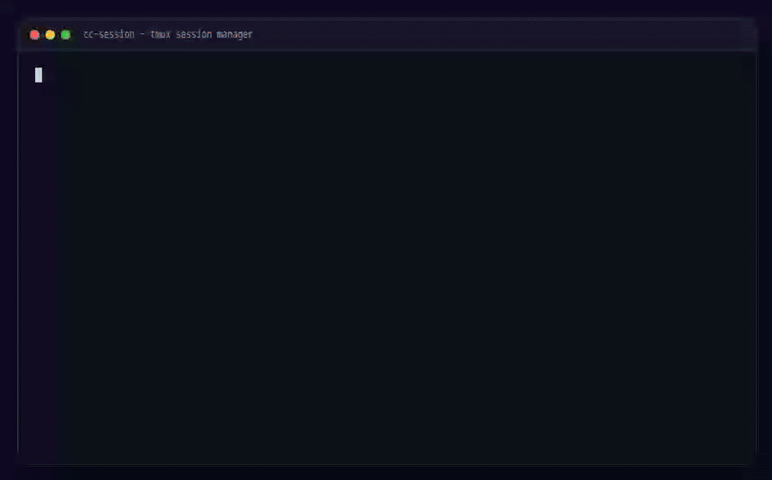

# cc-session

[](https://github.com/zzszmyf/cc-session/actions/workflows/ci.yml)
[](https://github.com/zzszmyf/cc-session/releases)
[](LICENSE)
[]()

Run interactive Claude Code sessions inside tmux, attach from anywhere, and optionally expose a browser terminal.

`cc-session` is a small shell wrapper around `tmux` (and optionally `ttyd`) for long-running coding agents. It keeps the agent alive when your SSH connection drops, lets you send a message without attaching, and gives you a browser UI when you are on a phone.

## Features

- Start an interactive Claude Code session in a named tmux session
- Attach / detach without killing the agent
- Send a prompt without attaching
- Tail the raw terminal log
- Optional web terminal via `ttyd`
- Multi-session hub with a picker
- Mobile-friendly notes, including the iOS Safari keyboard workaround

## Demo



Animated terminal rendering of the basic flow: start a session, send a prompt without attaching, then list sessions. Static frame: [`docs/demo.png`](docs/demo.png).

## Requirements

- Linux or macOS
- `tmux`
- Claude Code CLI (`claude`) in `PATH`, or set `CLAUDE_BIN`
- Optional: [`ttyd`](https://github.com/tsl0922/ttyd) for the web terminal

## Install

```bash
git clone https://github.com/zzszmyf/cc-session.git
cd cc-session
install -m 755 bin/cc-session ~/.local/bin/cc-session
```

Make sure `~/.local/bin` is in `PATH`.

## Quick start

```bash
cc-session start my-task "inspect this repo and propose a fix" ~/code/my-repo
cc-session attach my-task      # Ctrl-b d to detach; the agent keeps running
cc-session send my-task "continue"
cc-session logs my-task
cc-session stop my-task
```

List sessions:

```bash
cc-session ls
```

## Commands

| Command | What it does |
|---|---|
| `cc-session start <name> "<prompt>" [workdir]` | Start a named tmux session |
| `cc-session attach <name>` | Attach to the tmux session |
| `cc-session send <name> <text...>` | Send text + Enter without attaching |
| `cc-session logs <name>` | Tail the raw terminal log |
| `cc-session web <name> [port]` | Start a `ttyd` web terminal |
| `cc-session web-nginx <name> [port]` | Start `ttyd` behind an nginx subpath |
| `cc-session web-stop <name>` | Stop the web terminal |
| `cc-session hub [port]` | Start a persistent session picker |
| `cc-session hub-stop` | Stop the hub |
| `cc-session stop <name>` | Kill the tmux session |

## Configuration

All optional:

```bash
CC_SESSION_HOME=~/.cc-sessions   # session metadata/log directory
CC_SESSION_ZSHRC=~/.zshrc        # sourced before launching claude
CLAUDE_BIN=/path/to/claude
CC_PERMISSION_MODE=auto          # acceptEdits / manual / bypassPermissions
CC_MODEL=...                     # passed as --model when set
CC_EXTRA_ARGS='...'              # extra claude flags
CC_WEB_BIND=127.0.0.1            # ttyd bind address
CC_WEB_PORT=7681                 # default ttyd port
CC_WEB_BASE_PATH=/cc/            # reverse-proxy subpath
CC_WEB_USER=cc
CC_WEB_PASSWORD=...
```

## Web terminal

`ttyd` is optional. Bind it to loopback and put an authenticating reverse proxy in front of it:

```bash
cc-session web my-task 7681
# http://127.0.0.1:7681
```

For an nginx subpath, see [`examples/nginx-cc.conf`](examples/nginx-cc.conf). Always enable Basic Auth (or another auth layer) before exposing it beyond localhost.

### iOS Safari

xterm.js puts its helper textarea off-screen at `0x0`, which prevents iOS Safari from opening the software keyboard. The fix is a 1×1 fixed-position textarea plus a tap-to-focus handler. See [`docs/ios-safari-keyboard.md`](docs/ios-safari-keyboard.md).

## Security

- Do not expose `ttyd` directly to the internet.
- Use a reverse proxy with authentication and TLS.
- `CC_PERMISSION_MODE=bypassPermissions` gives the agent full access to the host; use it only in a disposable environment.
- Session logs can contain source code, command output, and secrets. Protect `~/.cc-sessions`.

## 中文快速开始

```bash
cc-session start 任务名 "你的初始任务" ~/你的项目
cc-session attach 任务名       # Ctrl-b d 退出但任务继续
cc-session send 任务名 "继续"
cc-session logs 任务名
cc-session stop 任务名
```

适合：长任务怕 SSH 断、想在手机上查看进度、需要多个 agent 会话并行。

## Related

Part of [feishu-agent-stack](https://github.com/zzszmyf/feishu-agent-stack) — tools for running coding agents from Feishu/Lark. See also [`feishu-agent-scheduler`](https://github.com/zzszmyf/feishu-agent-scheduler) for cron-style agent jobs and [`pi-managed-agents`](https://github.com/zzszmyf/pi-managed-agents) for managed sessions and sandboxes.

## License

MIT
